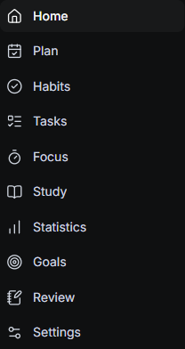

# Icon decision

| Set                                    | Fit for this app                                                                                                                          |
| -------------------------------------- | ----------------------------------------------------------------------------------------------------------------------------------------- |
| [Lucide](https://lucide.dev/)          | Clean outline family, adjustable stroke and size, already part of the existing stack. Chosen.                                             |
| [Phosphor](https://phosphoricons.com/) | Several weights and expressive alternatives; useful when a product needs more visual variety.                                             |
| [Tabler](https://tabler.io/icons)      | Broad outline catalogue with a similarly restrained appearance. A good alternative, but replacing the existing set adds no clear benefit. |

Tempo uses Lucide throughout. Sidebar icons share an 18 px size and 1.75 stroke: House, CalendarCheck, CircleCheck, ListTodo, Timer, BookOpen, ChartNoAxesColumnIncreasing, Target, NotebookPen and Settings2. Journal navigation uses BookOpen. Controls use the same stroke weight with sizes appropriate to their context.

[Light preview](icon-preview.svg)
